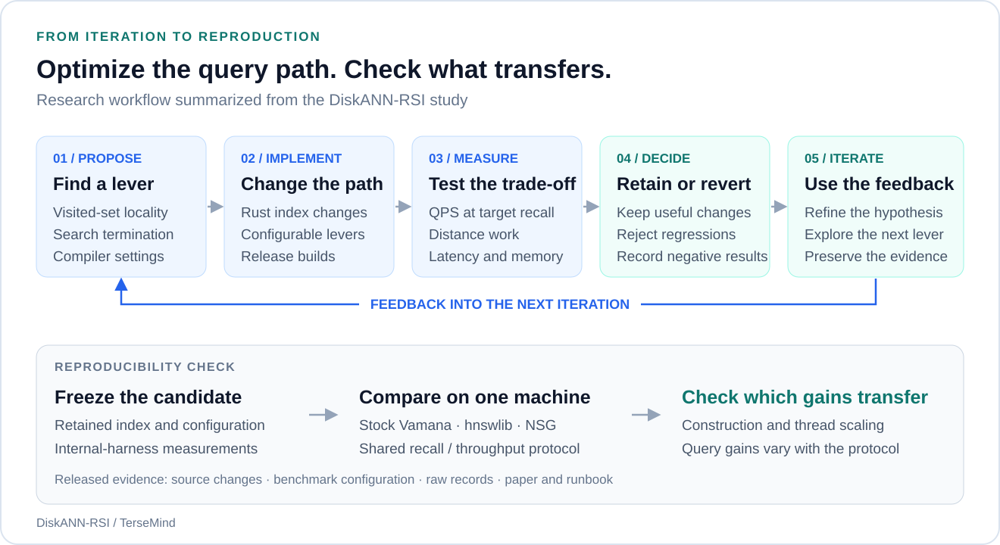
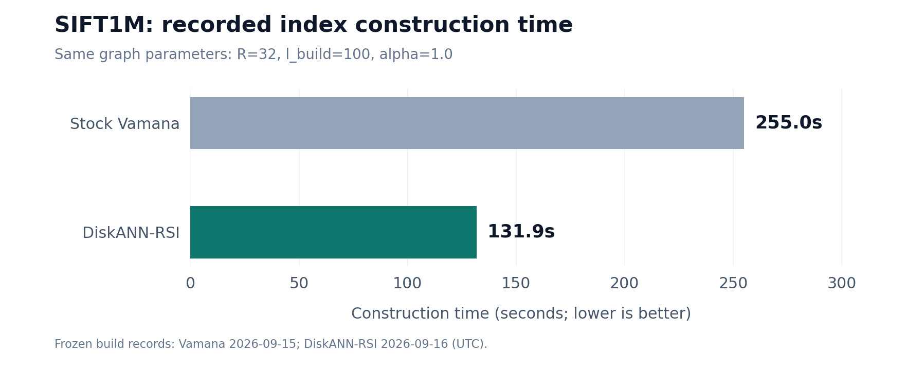
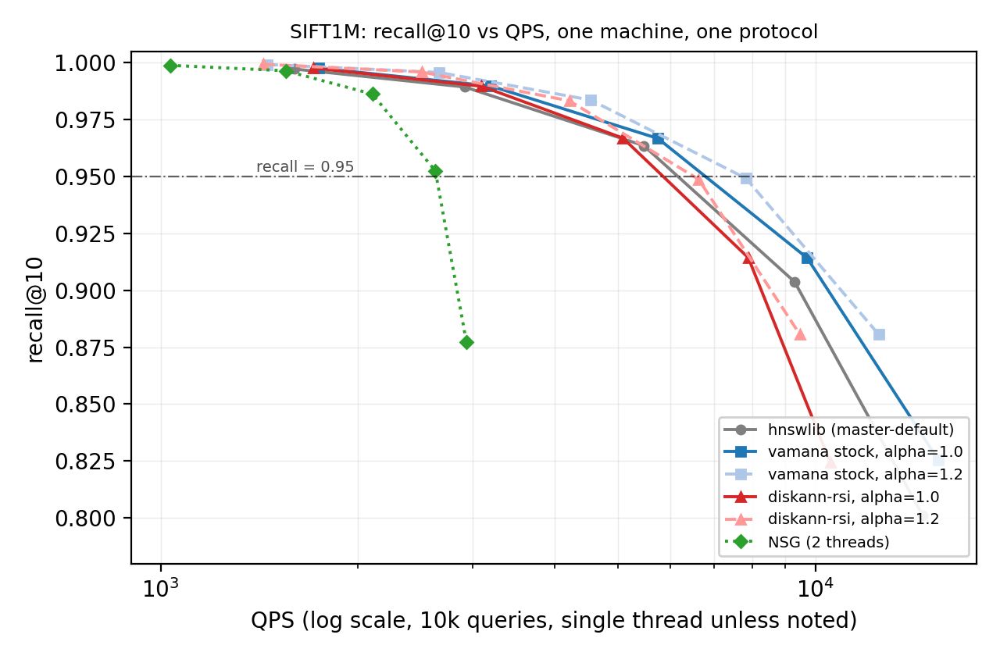

<h1 align="center">DiskANN-RSI</h1>

<p align="center"><strong>Automated Query-Path Optimization for Rust-Native Vector Search</strong></p>
<p align="center">Propose. Benchmark. Retain. Reproduce.</p>

<p align="center">
  <a href="#overview">Overview</a> ·
  <a href="#optimization-loop">Optimization Loop</a> ·
  <a href="#results">Results</a> ·
  <a href="#quick-start"><strong>Quick Start</strong></a> ·
  <a href="paper/main.pdf">Paper</a> ·
  <a href="README.zh-CN.md">简体中文</a>
</p>

<p align="center">
  <a href="rust-toolchain.toml"></a>
  <a href="LICENSE.txt"></a>
  <a href="docs/BENCHMARKS.md"></a>
  <a href="paper/main.pdf"></a>
</p>

## Overview

**Can an automated research loop improve a vector index—and do those improvements survive a different evaluation protocol?** DiskANN-RSI studies this question through the query path of a Rust-native Vamana/DiskANN index.

The RSI loop proposes, implements and measures changes to visited sets, search termination and compilation. Useful changes are retained; regressions and rejected ideas become part of the experimental record. The resulting index is then compared with **stock Vamana, hnswlib and NSG on one machine** to examine which gains transfer.

This repository releases the optimized index, the [patch relative to upstream](docs/final_patch.diff), [raw measurement records](bench/results/) and a [reproduction guide](docs/REPRODUCE.md). The workflow below summarizes the optimization study; the runnable entry point reproduces index benchmarks.

## Optimization Loop

<p align="center">
  <a href="docs/media/rsi-loop.svg"></a>
</p>

<p align="center"><em>Iterate with feedback. Check the retained candidate against a shared evaluation protocol.</em></p>

**Propose → Implement → Measure → Retain or revert → Iterate.** The optimization target is throughput at a recall constraint, rather than throughput alone. A separate comparison asks whether gains measured inside that loop persist against independent baselines.

### What the loop changed

| Optimization | Mechanism | Observation in the study |
| :--- | :--- | :--- |
| **Visited-set locality** | Epoch-stamped dense arrays with 16-bit stamps and an O(1) epoch reset. | Stamp storage **4 MB → 2 MB** at 1M points; instrumented visited-set time **−45%**. |
| **Adaptive termination** | Stop expansion using a frontier-to-kth-distance ratio after a minimum hop count. | At ratio 1.2, about **10–50% fewer distance computations** at L=60–200, with recall reported unchanged. |
| **Compilation** | Fat LTO enables cross-crate inlining along the provider-to-distance-kernel path. | **10–12% higher search QPS** in the 10K A/B experiment. |
| **Configuration sweeps** | Expose prefetch, beam width and early-stop parameters in `job.json`. | Default prefetch 8 remained best on the study host; beam width above 1 regressed at 1T. |

These observations come from different experiments and **should not be added together**. See the [per-optimization measurements](docs/BENCHMARKS.md#4-per-optimization-measurements-rsi-harness-sift1m) for dataset and protocol details.

<details>
<summary><strong>Learning from rejected candidates</strong></summary>

- **SQ8 traversal + full-precision reranking:** no useful QPS gain in the measured cache-resident regime.
- **Candidate-queue merge insertion:** slower; reverted.
- **Random-projection reordering:** no measurable effect on this host.
- **Partial-distance early exit:** overhead outweighed the savings for the 128-dimensional kernel.
- **Aggressive early stopping:** ratio 1.15 reduced comparisons but capped recall; 1.2 was retained.
- **Recall-stacking configurations:** the separate 10K synthetic study raised recall@10 from 0.909 to 1.000 by trading additional construction/search work for recall.

[Full negative results and parameter sweeps](docs/BENCHMARKS.md)

</details>

## Results

### Inside the loop, then under a shared protocol

| Evaluation | Observed result | Interpretation |
| :--- | :--- | :--- |
| **RSI harness · SIFT1M** | QPS at recall ≥ 0.95: **2994.6 → 4641.1 (+55%)**. | Improvement against the optimizer's own baseline and settings. |
| **Shared protocol · index construction** | Stock Vamana **255.0s**; DiskANN-RSI **131.9s**. | About **1.9× faster construction** in this session. |
| **Shared protocol · thread scaling** | DiskANN-RSI **1.87×** from 1T to 2T; stock Vamana **1.75×** at Ls=64. | Better scaling, while stock Vamana still has higher absolute QPS. |
| **Shared protocol · query throughput** | DiskANN-RSI **5078 QPS**; stock Vamana **5708 QPS** at recall ≈ 0.967. | The internal +55% gain **does not transfer uniformly** to the cross-system comparison. |

<p align="center">
  <a href="docs/media/build-time.svg"></a>
</p>

The unified comparison uses the **2026-09-16 session**, SIFT1M (1M × 128, L2), recall@10 and 10,000 queries with three repetitions on a **2-vCPU cloud VM, 3.6 GB RAM + 8 GB swap, OpenCloudOS 9.4**. Figures and tables summarize existing measurements, not a new benchmark run.

### Recall–throughput trade-offs

<p align="center">
  <a href="paper/fig_recall_qps.pdf"></a>
</p>

*Existing paper figure reconstructed from the frozen records by [`bench/plots/recall_qps.py`](bench/plots/recall_qps.py). Each plotted operating point aggregates the available records; NSG uses two threads, the other series use one.*

At low search depths, the optimized index trails stock Vamana; the gap narrows at higher recall. Protocol differences, cache behavior and per-expansion overhead help explain why local wins do not automatically become cross-system wins. [Read the analysis](docs/BENCHMARKS.md#6-why-the-rsi-harness-55-does-not-transfer).

<details>
<summary><strong>View the headline comparison table</strong></summary>

QPS at recall ≥ 0.95, using the headline values reported in the paper:

| System | QPS | Recall@10 | Construction | Peak memory |
| :--- | ---: | ---: | ---: | ---: |
| hnswlib (master-default) | **6077** | 0.9637 | 238.6s | 1.31 GB |
| Stock Vamana (α=1.0) | 5708 | 0.9667 | 255.0s | 1.27 GB |
| **DiskANN-RSI (α=1.0)** | 5078 | 0.9669 | **131.9s** | 1.28 GB |
| NSG (**2T**) | 2643 | 0.9525 | 451s + kNN graph | 1.40 GB |

All searches are 1T except NSG. NSG additionally needs an efanna kNN graph precomputation taking several hours. Per-repetition medians and paper headline throughput are distinct fields in the raw records; see [full tables and measurement notes](docs/BENCHMARKS.md).

</details>

## Quick Start

Use the Rust toolchain pinned in [`rust-toolchain.toml`](rust-toolchain.toml). The preparation step downloads SIFT1M and writes the paths used by `job.json`.

```bash
git clone https://github.com/kangzhanhui/diskann-rsi.git
cd diskann-rsi

python3 -m venv .venv
source .venv/bin/activate
python -m pip install numpy h5py
python tools/prepare_sift1m.py

cargo build --release -p diskann-benchmark
cargo run --release -p diskann-benchmark -- \
  run --input-file job.json --output-file benchmark-results.json
```

Adjust graph parameters, thread counts and the search ladder in [`job.json`](job.json) for your experiment. For a comparable remeasurement, use the host and baseline settings in the [reproduction guide](docs/REPRODUCE.md).

<details>
<summary><strong>Inspect inputs and validate a benchmark configuration</strong></summary>

```bash
# Inspect the available job types.
cargo run --release -p diskann-benchmark -- inputs

# Validate the configured job without running the benchmark.
cargo run --release -p diskann-benchmark -- \
  run --input-file job.json --output-file benchmark-results.json --dry-run
```

The checked-in `job.json` is the RSI-harness configuration. The paper's shared-protocol comparison uses separately documented operating points. Re-running this job alone does not reproduce all cross-system measurements.

</details>

## Paper and Reproduction

| Resource | Contents |
| :--- | :--- |
| [Paper PDF](paper/main.pdf) · [LaTeX source](paper/main.tex) | System design, optimization measurements and reproducibility analysis. |
| [Benchmark results](docs/BENCHMARKS.md) | Recall–QPS ladders, thread scaling, individual changes and negative results. |
| [Reproduction guide](docs/REPRODUCE.md) | Host configuration, baseline settings and measurement procedure. |
| [Raw records](bench/results/) | Frozen JSONL measurements, including earlier sessions identified in the benchmark notes. |
| [RSI patch](docs/final_patch.diff) | Query-path changes relative to upstream. |

## Repository

```text
├── diskann*/         # Rust index, providers, vector kernels and benchmark crates
├── job.json          # RSI-harness benchmark configuration
├── bench/
│   ├── results/      # Frozen measurement records
│   └── plots/        # Reproducible figures
├── docs/             # Benchmark notes, reproduction guide and workflow figure
├── paper/            # Paper PDF, LaTeX source and recall–QPS figure
└── tools/            # Dataset preparation and measurement utilities
```

## Citation

```bibtex
@misc{diskann-rsi-2026,
  title  = {DiskANN-RSI: Query-Path Optimizations for a Rust-Native Vamana Index,
            and a Same-Machine Reproducibility Study},
  author = {Kang, Zhanhui},
  year   = {2026},
  howpublished = {\url{https://github.com/kangzhanhui/diskann-rsi}}
}
```

## Acknowledgements and License

Built on the Rust rewrite of [microsoft/DiskANN](https://github.com/microsoft/DiskANN). NSG-related code is attributed to [ZJULearning/nsg](https://github.com/ZJULearning/nsg). See [LICENSE.txt](LICENSE.txt) and [NOTICE.txt](NOTICE.txt).

RSI modifications and project-authored benchmark and reproduction tools are Copyright (C) 2026 TerseMind, under MIT. Upstream and third-party code retain their original copyright notices.
