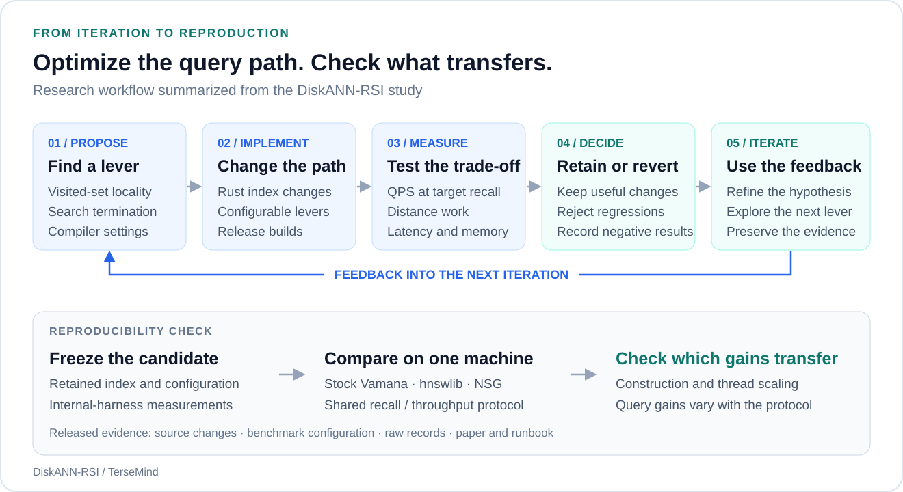
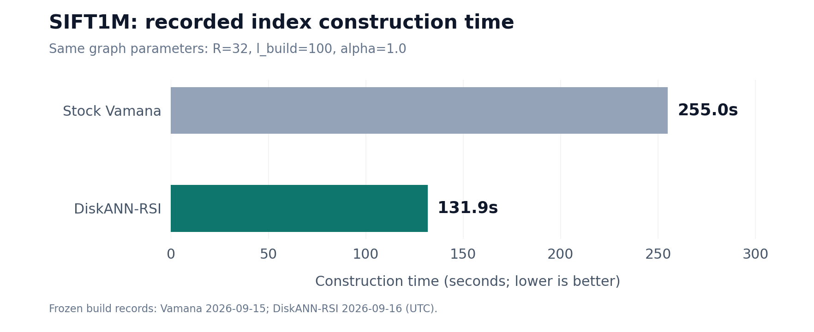
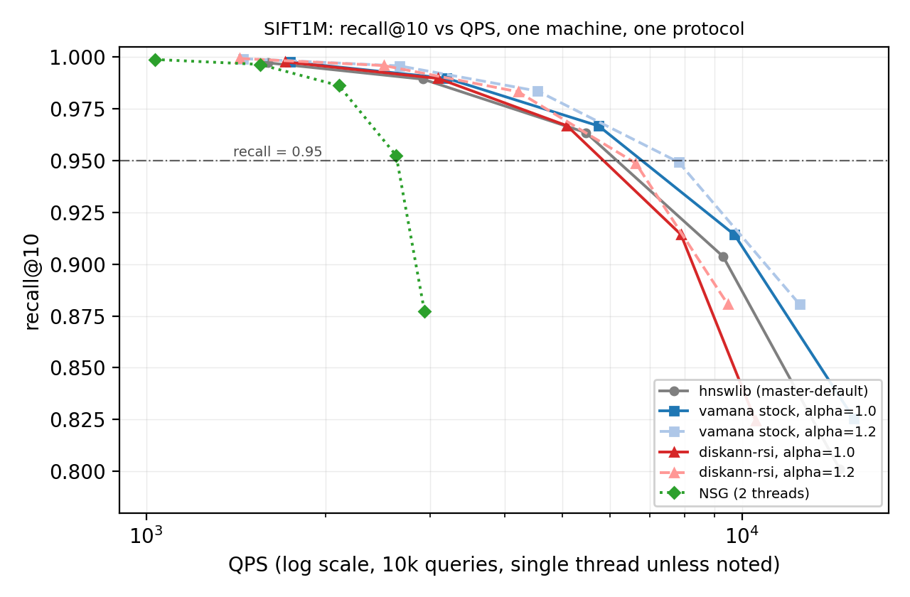

<h1 align="center">DiskANN-RSI</h1>

<p align="center"><strong>以自动研究循环优化 Rust 原生向量检索</strong></p>
<p align="center">提出优化 · 测量反馈 · 保留改进 · 复核收益</p>

<p align="center">
  <a href="#项目概览">项目概览</a> ·
  <a href="#自动优化流程">自动优化流程</a> ·
  <a href="#实验结果">实验结果</a> ·
  <a href="#快速开始"><strong>快速开始</strong></a> ·
  <a href="paper/main.pdf">论文</a> ·
  <a href="README.md">English</a>
</p>

<p align="center">
  <a href="rust-toolchain.toml"></a>
  <a href="LICENSE.txt"></a>
  <a href="docs/BENCHMARKS.md"></a>
  <a href="paper/main.pdf"></a>
</p>

## 项目概览

**自动研究循环能否优化向量索引？在循环内部取得的收益，换用统一测试协议后还能保留多少？** DiskANN-RSI 围绕 Rust 原生 Vamana/DiskANN 索引的查询路径，研究这两个问题。

RSI 循环提出、实现并测量访问集合、搜索终止与编译方面的改动：保留有效方案，记录回退与失败，再将最终索引与 **stock Vamana、hnswlib 和 NSG 放在同一台机器上比较**，检验收益是否迁移。

仓库提供优化后的索引、[相对上游的补丁](docs/final_patch.diff)、[原始测量记录](bench/results/)与[复现指南](docs/REPRODUCE.md)。下图总结研究中的优化过程；仓库的运行入口用于复现索引基准测试。

## 自动优化流程

<p align="center">
  <a href="docs/media/rsi-loop.svg"></a>
</p>

<p align="center"><em>用实验反馈推进迭代，再以统一协议复核最终候选。</em></p>

**提出优化 → 实现 → 测量 → 保留或回退 → 继续迭代。** 优化目标是在召回率约束下提高吞吐；单独的同机比较则检验内部收益是否能迁移到独立基线。

### 循环带来了哪些改动

| 优化方向 | 实现机制 | 研究中的观测 |
| :--- | :--- | :--- |
| **访问集合局部性** | 16 位 epoch 标记的稠密数组，以 O(1) epoch 递增清空。 | 100 万点时标记存储 **4 MB → 2 MB**；插桩测得访问集合耗时 **−45%**。 |
| **自适应终止** | 达到最小跳数后，依据搜索前沿与第 k 近距离之比停止扩展。 | ratio=1.2、L=60–200 时，距离计算约减少 **10–50%**，报告的召回率不变。 |
| **编译优化** | Fat LTO 促进 provider 到距离核路径上的跨 crate 内联。 | 10K A/B 实验中搜索 QPS 提高 **10–12%**。 |
| **配置扫描** | 在 `job.json` 中开放预取、beam width 与提前终止参数。 | 研究机器上预取默认值 8 仍最佳；单线程下 beam width 大于 1 出现退化。 |

这些观测来自不同实验，**不能将收益相加**。[各项优化的测量条件](docs/BENCHMARKS.md#4-per-optimization-measurements-rsi-harness-sift1m)中保留了数据集与协议说明。

<details>
<summary><strong>被否决的方案也提供反馈</strong></summary>

- **SQ8 遍历＋全精度重排：**在测试的缓存驻留场景中没有取得有用的 QPS 收益。
- **候选队列合并插入：**更慢，已回退。
- **随机投影重排：**在该机器上无可测收益。
- **部分距离提前退出：**128 维距离核的额外开销超过节省。
- **更激进的提前终止：**ratio=1.15 虽减少距离计算，但限制召回率上限，最终保留 1.2。
- **提高召回率的构建配置：**独立的 10K 合成实验通过增加构建或搜索工作量，将 recall@10 从 0.909 提高至 1.000。

[完整失败结果与参数扫描](docs/BENCHMARKS.md)

</details>

## 实验结果

### 从循环内部收益到统一协议复核

| 实验口径 | 观测结果 | 含义 |
| :--- | :--- | :--- |
| **RSI 内部测试 · SIFT1M** | recall ≥ 0.95 时 QPS **2994.6 → 4641.1（+55%）**。 | 相对优化器自身基线与配置的提升。 |
| **统一协议 · 索引构建** | Stock Vamana **255.0 秒**；DiskANN-RSI **131.9 秒**。 | 本次测试会话中构建速度约为 **1.9 倍**。 |
| **统一协议 · 线程扩展** | Ls=64 时，DiskANN-RSI 从 1T 到 2T 为 **1.87 倍**，stock Vamana 为 **1.75 倍**。 | 扩展倍率更好；stock Vamana 的绝对 QPS 仍更高。 |
| **统一协议 · 查询吞吐** | recall ≈ 0.967 时，DiskANN-RSI **5078 QPS**，stock Vamana **5708 QPS**。 | 内部 +55% 收益**没有全面迁移**到跨系统比较。 |

<p align="center">
  <a href="docs/media/build-time.svg"></a>
</p>

统一比较来自 **2026-09-16 的测试会话**：SIFT1M（100 万 × 128 维，L2）、recall@10、1 万条查询、重复三次；机器为 **2 vCPU、3.6 GB 内存＋8 GB swap，OpenCloudOS 9.4**。本页图表整理已有测量，没有新增基准运行。

### 召回率与吞吐之间的取舍

<p align="center">
  <a href="paper/fig_recall_qps.pdf"></a>
</p>

*论文已有图表，由 [`bench/plots/recall_qps.py`](bench/plots/recall_qps.py) 根据冻结记录重建，每个工作点聚合可用记录。NSG 使用双线程，其余曲线使用单线程。*

在较浅搜索深度下，优化索引的吞吐低于 stock Vamana；提高召回率后差距收窄。协议差异、缓存行为与每次扩展的额外开销，共同解释了局部收益为何未直接转化为跨系统优势。[详细分析](docs/BENCHMARKS.md#6-why-the-rsi-harness-55-does-not-transfer)。

<details>
<summary><strong>展开论文中的主要比较表</strong></summary>

下表采用论文报告的 recall ≥ 0.95 工作点吞吐：

| 系统 | QPS | Recall@10 | 构建耗时 | 峰值内存 |
| :--- | ---: | ---: | ---: | ---: |
| hnswlib（master-default） | **6077** | 0.9637 | 238.6 秒 | 1.31 GB |
| Stock Vamana（α=1.0） | 5708 | 0.9667 | 255.0 秒 | 1.27 GB |
| **DiskANN-RSI（α=1.0）** | 5078 | 0.9669 | **131.9 秒** | 1.28 GB |
| NSG（**双线程**） | 2643 | 0.9525 | 451 秒＋kNN 图 | 1.40 GB |

除 NSG 外，搜索均为单线程。NSG 还需要耗时数小时的 efanna kNN 图预计算。原始记录中的每次重复中位数与论文报告吞吐是不同字段；参见[完整表格及测量说明](docs/BENCHMARKS.md)。

</details>

## 快速开始

使用 [`rust-toolchain.toml`](rust-toolchain.toml) 固定的 Rust 工具链。准备脚本会下载 SIFT1M，并写入 `job.json` 使用的路径。

```bash
git clone https://github.com/kangzhanhui/diskann-rsi.git
cd diskann-rsi

python3 -m venv .venv
source .venv/bin/activate
python -m pip install numpy h5py
python tools/prepare_sift1m.py

cargo build --release -p diskann-benchmark
cargo run --release -p diskann-benchmark -- \
  run --input-file job.json --output-file benchmark-results.json
```

在 [`job.json`](job.json) 中调整图参数、线程数与搜索深度。需要可比较的重新测量时，请使用[复现指南](docs/REPRODUCE.md)中的机器与基线设置。

<details>
<summary><strong>查看输入类型并验证配置</strong></summary>

```bash
# 查看可用的任务输入类型。
cargo run --release -p diskann-benchmark -- inputs

# 仅校验配置，不执行基准测试。
cargo run --release -p diskann-benchmark -- \
  run --input-file job.json --output-file benchmark-results.json --dry-run
```

仓库中的 `job.json` 是 RSI 内部测试配置；论文的统一协议比较另有工作点设置。仅运行这个任务不能复现全部跨系统测量。

</details>

## 论文与复现材料

| 入口 | 内容 |
| :--- | :--- |
| [论文 PDF](paper/main.pdf) · [LaTeX 源文件](paper/main.tex) | 系统设计、优化测量与复现分析。 |
| [基准结果](docs/BENCHMARKS.md) | 召回率–QPS 曲线、线程扩展、单项优化与失败结果。 |
| [复现指南](docs/REPRODUCE.md) | 机器配置、基线参数与测量步骤。 |
| [原始记录](bench/results/) | 冻结的 JSONL 测量，包含测试说明中标明的较早会话。 |
| [RSI 补丁](docs/final_patch.diff) | 相对上游的查询路径改动。 |

## 仓库结构

```text
├── diskann*/         # Rust 索引、provider、向量核与基准 crate
├── job.json          # RSI 内部测试配置
├── bench/
│   ├── results/      # 冻结测量记录
│   └── plots/        # 可重建图表
├── docs/             # 测试说明、复现指南与流程图
├── paper/            # 论文 PDF、LaTeX 与召回率–QPS 图
└── tools/            # 数据集准备与测量工具
```

## 引用

```bibtex
@misc{diskann-rsi-2026,
  title  = {DiskANN-RSI: Query-Path Optimizations for a Rust-Native Vamana Index,
            and a Same-Machine Reproducibility Study},
  author = {Kang, Zhanhui},
  year   = {2026},
  howpublished = {\url{https://github.com/kangzhanhui/diskann-rsi}}
}
```

## 致谢与许可证

基于 [microsoft/DiskANN](https://github.com/microsoft/DiskANN) 的 Rust 重写版本。NSG 相关代码归属于 [ZJULearning/nsg](https://github.com/ZJULearning/nsg)。详见 [LICENSE.txt](LICENSE.txt) 与 [NOTICE.txt](NOTICE.txt)。

RSI 修改及本项目编写的测试、复现工具归 Copyright (C) 2026 TerseMind 所有，采用 MIT 许可证。上游与第三方代码保留原有版权声明。
